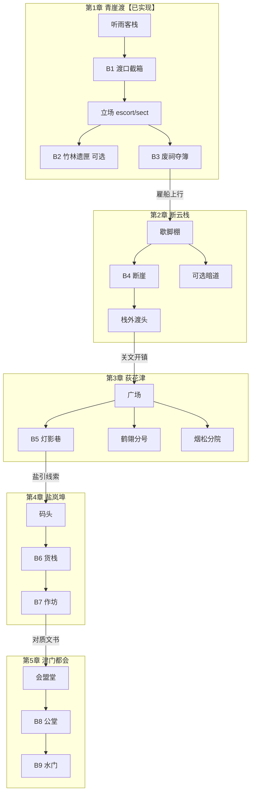

# 武侠战棋 · 大地图剧情大纲 v2.0

- 版本：v2.0
- 日期：2026-10-15
- 权威规则：`武侠战棋_GDD_v2.0.md`（**【已定】不可违背**）
- 参照气质：《侠客风云传》式城镇／门派／野外自由行走、日程节奏、养成触发、人物关系与多结局
- 实现锚点：青崖渡探索 + B1—B3（已实现）；基线工程 `tactics-tri/`
- 状态说明：本文新提案一律标 **【建议】**；与 GDD【已定】冲突处写明**调和方式**，不以参考作覆盖已定规则。
- 人物与门派均为**原创**，不照搬《侠客风云传》人名、门派名或主线剧情。

> **取代关系【建议，待确认】**：本文拟整体取代  
> `武侠战棋_大地图设计_v1.0.md` 与 `武侠战棋_主线剧情与文案_v1.0.md` 作为大地图＋剧情的统一大纲。  
> 两份 v1.0 中可保留内容见第 11 节；未确认前仍可作实现对照参考。

---

## 1. 参考作品要点归纳：《侠客风云传》大地图与剧情

下列为玩法／结构归纳，**非抄袭清单**；本项目只借「节奏与玩家自由感」，不借原作设定。

| 维度 | 《侠客风云传》常见做法 | 对本项目的启发 |
|------|------------------------|----------------|
| **空间** | 城镇、门派驻地、野外可连续走动；多区域切换形成「江湖地图」感 | 强化「走到」地点，拒绝纯节点点选 |
| **时间** | 日夜／时辰推进；NPC 有日程，部分事件限时段 | 「过一天」可成为章节节奏与奇遇开关 |
| **养成** | 练功、交友、学艺穿插在探索中；事件按条件触发 | 探索奖励应落到武学／同伴／战棋变体，而非纯文本 |
| **关系** | 好感度影响支线、助战、结局 | 人物选择应有可见后果，但不宜做成无尽刷好感 |
| **势力** | 正邪门派、官府、江湖组织并存，立场拉扯 | 少而精的势力轴，服务关卡变体与授艺 |
| **任务结构** | 主线推进世界状态；支线丰满人物；奇遇制造意外与秘籍 | 主线保底可通关；支线／奇遇给流派与结局差分 |
| **结局** | 多结局绑定关键选择与人物线 | 少量可辨识结局，不追求恋爱游戏式全量分支树 |

### 1.1 与本项目 GDD【已定】的冲突与调和

| 参考作做法 | GDD【已定】／硬边界 | **【建议】调和** |
|------------|---------------------|------------------|
| 近似开放世界、大地图无缝跑图 | **小型可自由行走区域**；首版不以大型开放世界为目标；设计主轴 A 战棋 > B 武学 > C 叙事 | 多章「小型漫游区」＋交互转场（渡船／关文／栈道），**不做**无缝大地图、游荡刷怪、马匹跨洲 |
| 完整时辰＋全 NPC 日程 | GDD 原型明确：**首版不做全套 NPC 日程／昼夜经济／随机巡逻**（12.2／16.4） | 采用**轻量日程**：仅「上午／午后／夜」三相位＋少量时段事件；多数 NPC 仍可原地交互 |
| 0—100 好感条反复刷 | 门派关系建议为**事件驱动五档**；不鼓励无限刷支线涨分（GDD 11） | **人物情谊**用关键事件档（疏远／普通／信赖／生死交）＋旗标；门派仍用五档；无日常送礼刷条 |
| 拜入一门派锁死身份 | 不强制主角终身单门派；武学有限自由混搭；共用谱库＋独立学习【已定】 | 可「客卿学艺／短期寄居」，**不**做成唯一终身拜师锁构筑 |
| 大量奇遇冲淡主线 | 叙事服务于角色与关卡；关键武学主线保底 | 奇遇有上限与章节窗口；绝不锁死通关必需战术能力 |
| Q 版／偏娱乐人设比例 | 人物 **约 3.5—4.5 头身**精致像素【已定】（非 2.5 头身 Q 版） | 气质可「市井江湖、人情冷暖」，美术比例仍守 GDD |

---

## 2. 世界观【建议】

### 2.1 一句话

**漕河九湾**是连通山门与盐埠的内河商路。官家用**渡簿**记谁走过哪段水；镖行凭契护送；山门凭印稽查。近年有人改簿、造契、换泥——不是简单劫镖，而是要把某些人从「水路历史上」抹掉。

### 2.2 玩家身份

三人小队并非名门嫡传，而是在青崖渡被卷进「两份货单」的过路武者（战术原型：剑／枪／拳）。剧情称呼可用「渡口同行」；正式姓名见第 6 节（原创）。

### 2.3 主题

- **名单权**：谁有权决定「谁该被记住、谁该消失」。
- **契与印**：守约与核验都可能是正义，也可能沦为刀柄。
- **战棋优先**：每段剧情最终落到可辨识的战场目标（歼灭、取物撤离、败首领取证、护送坚守等）。

### 2.4 气质

冷青水面、竹影、残祠、灯下对质；少飞升玄幻，多人间算计与武学规矩。视觉服从 GDD：斜 45°、精致像素、约 3.5—4.5 头身。

### 2.5 与 v1.0 世界观的关系

保留「内河商路＋渡簿造假」主轴；强化《侠客风云传》式**可走动的市井与门派驻地感**，但空间仍拆成有限区域，不扩成九州开放世界。

---

## 3. 大地图结构与地点【建议】

### 3.1 总原则（服从【已定】）

- 大地图＝**章节／区域的组织与解锁节奏**，不是可点击章节节点 UI。
- 每一章＝**1 张（或室内外各 1）小型可自由行走漫游图**＋若干**独立战棋关卡**。
- 跨区用门口／渡口／栈道／关文等**走到并交互**切图；探索移动为实时八向连续，无战棋 AP。
- 战斗地图不要求与探索瓦片 1:1。

### 3.2 世界轴（五区域，可回访）

```text
【建议】漕河九湾地理示意（河水大致西←→东；北为山门余脉）

        北 · 栖霞余脉 / 山门分院
              │
    ┌─────────┼─────────┐
    │         │         │
  断云栈    青崖渡     荻花津
  (Ch2)     (Ch1)      (Ch3)
    │         │         │
    └──── 盐岚埠 ──────┘
           (Ch4)
              │
         津门都会
           (Ch5 收束)
```

| 区域 ID | 章 | 地名 | 定位（侠客风式功能） |
|---------|----|------|----------------------|
| `region_qingyadu` | 1 | **青崖渡** | 起点村镇渡口；客栈据点＋野外竹林／废祠【已实现】 |
| `region_danyun` | 2 | **断云栈** | 山野栈道＋歇脚棚；护送／暗道奇遇 |
| `region_dihuajin` | 3 | **荻花津** | 小型市镇；镖行分号与山门分院同镇对峙 |
| `region_yanlan` | 4 | **盐岚埠** | 码头货栈；伪簿作坊主线 |
| `region_jinmen` | 5 | **津门都会** | 会盟／水门终局；结局检定 |

> 地名相对 v1.0「雾津镇／河湾盐埠／都会口／上游古栈道」做了原创微调，避免与常见网文撞名；**青崖渡名称与 B1—B3 实现保持不变**。

### 3.3 第 1 章《青崖渡》——【已定结构＋已实现】

室外 48×30、客栈 14×10；地点与旗标以 GDD 第 12—15 章及现网为准。

| 地点 | 类型 | 战斗／功能 |
|------|------|------------|
| 听雨客栈 | 据点 `explore_hub` | 接任务、立场、谱库、演武、整备 |
| 渡口 | 主线 | **B1《渡口截箱》** |
| 竹林旧道 | 可选 | **B2《竹林遗匣》** |
| 废祠 | 主线 | **B3《废祠夺簿》**（escort／sect 变体） |

旗标：`S0` 接任务 → `S1` B1 → `S2` 学谱／演武／选立场 → `S3` B2 可选或 B3 → 取渡簿结章。  
立场仅一次；B2 非 B3 前置；首通奖励一次性。

**【建议】侠客风味补强（不改已实现碰撞与战斗 ID）**：

- 客栈夜相位可触发一次「酒客传闻」奇遇入口（见第 8 节），奖励调查旗标或少量道具，**不**重复发 B1—B3 奖励。
- 结章后室外增加「雇船上行」交互 → 断云栈（转场待落地）。

### 3.4 第 2 章《断云栈》【建议】

| 地点 ID | 功能 | 类型 |
|---------|------|------|
| `camp_shed` 断云歇脚棚 | 临时据点（存档、弱整备） | 探索 |
| `cliff_pass` 断崖关卡 | 主线 **B4**：护送知情商旅或坚守关口 | 战棋 |
| `smuggle_cave` 走私暗道 | 可选：取证＋撤离（B2 机制变体） | 战棋可选 |
| `upstream_ferry` 栈外渡头 | 核对拓片 → 开往荻花津 | 探索转场 |
| `herb_slope` 药坡 | **奇遇**：采药／救跌落药农（见第 8 节） | 探索 ± 小战 |

### 3.5 第 3 章《荻花津》【建议】——市镇感核心章

| 地点 ID | 功能 | 类型 |
|---------|------|------|
| `jin_square` 荻花广场 | 连续漫游主区；市集、传闻板 | 探索 |
| `crane_branch` 鹤翎分号 | 镖行侧支线／切磋（偏 escort） | 探索 ± 切磋战 |
| `mistpine_court` 烟松分院 | 山门侧支线／师承条件（偏 sect） | 探索 ± 切磋战 |
| `night_lane` 灯影巷 | 主线 **B5**：巷战、侧袭强化 | 战棋 |
| `old_archive` 旧籍楼 | 可选谱库扩展 | 探索／可选战 |
| `tea_house` 半日茶寮 | **日程**：午后开放人物线对话 | 探索 |

立场后果在此章**显性化**：对立侧戒备，**不封死**夜巷主线入口。

### 3.6 第 4 章《盐岚埠》【建议】

| 地点 ID | 功能 | 类型 |
|---------|------|------|
| `salt_wharf` 盐岚码头 | 漫游＋封锁线调查 | 探索 |
| `warehouse_row` 货栈长廊 | 主线 **B6**：多箱分路（B1 课进阶） | 战棋 |
| `forge_ledger` 墨引作坊 | 主线 **B7**：首领＋取证（B3 课进阶） | 战棋 |
| `neutral_inn` 渡引客栈 | 整备据点 | 探索 |
| `night_watch` 更鼓台 | **奇遇**：夜相位守更／截伪簿信使 | 探索 ± 战 |

### 3.7 第 5 章《津门都会》【建议】

| 地点 ID | 功能 | 类型 |
|---------|------|------|
| `guild_hall` 九湾会盟堂 | 回顾关键选择；展示结局倾向 | 探索 |
| `court_yard` 公堂外院 | 主线 **B8**：援军变体随立场／情谊 | 战棋 |
| `river_gate` 水门 | 终局 **B9** | 战棋 |
| `epilogue_dock` 尾声码头 | 结算、回访 | 探索 |

### 3.8 跨章连接【建议】



**不做**：开放世界无缝、章节节点点击、游荡遭遇刷怪圈。

---

## 4. 时间与日程系统【建议】

### 4.1 设计目标

借《侠客风云传》的「过一天、等人、卡时段事件」节奏，但**压缩复杂度**，避免拖慢战棋主循环。

### 4.2 轻量三相位（非完整时辰表）

| 相位 | 典型用途 | 推进方式 |
|------|----------|----------|
| **上午** | 主线 NPC 易找、市集开放、切磋 | 进入新区域默认上午；主线大战后可跳到午后 |
| **午后** | 人物线／茶寮对话、部分支线 | 完成一场战棋、或在据点选「休息至午后」 |
| **夜** | 巷战、守更奇遇、酒客传闻 | 据点选「等到入夜」；部分主线强制入夜（如 B5） |

- **【建议】**同一区域内，玩家可在据点**主动推进相位**（每天限推进次数或按「休息」消耗），避免无意义空跑等 NPC。
- **【建议】**多数装饰性 NPC **不**做完整日程移动；仅 3—6 个关键角色在相位切换时换对话／换站位标记。
- **【已定边界】**探索仍无 AP；相位不是战斗资源。

### 4.3 与事件触发

| 触发类型 | 条件例子 | 说明 |
|----------|----------|------|
| 主线门闸 | 旗标＋相位（如 B5 需夜） | 白天走到巷口给「等入夜」提示，不封死道路 |
| 人物情谊 | 指定相位＋好感档＋主线进度 | 替代刷好感条 |
| 奇遇窗口 | 章节内、未完成、随机或伪随机一次 | 错过不卡主线 |
| 门派关系 | 仅关键事件改五档 | 与 GDD 11 一致 |

### 4.4 养成节奏（服从已定成长）

日程服务的是**何时触发对话／奇遇／切磋**，不是另开「时辰练功熟练度」。

- 练功／学招：仍在据点谱库与演武区（共用谱库、独立学习精进【已定】）。
- 切磋：日程开放的高手战，奖励秘籍或心得（有限、可规划）。
- **禁止**：靠反复打低难度遇敌刷武学熟练度（GDD 武学成长已定）。

### 4.5 第一章落地范围【建议】

Ch1 已实现可不强改日程：仅预留 `day_phase` 存档字段；夜相位酒客传闻可作为 Ch1 回访彩蛋。Ch2 起正式启用三相位。

---

## 5. 主线章节大纲【建议】

总体一句话：从青崖渡「两份货单」追到盐岚伪簿网，在津门揭开改簿者——第一章立场与中途人物情谊，决定终局谁助战、谁冷眼。

### 第 1 章《青崖渡·两份货单》——骨架【已实现】；文案可替换样例

| 节拍 | 行动 | 内容 |
|------|------|------|
| 起 | 听雨客栈接委托 | 失踪封箱、两份货单 |
| 承 | B1 渡口截箱 | 《回锋剑谱》入谱库 |
| 转 | 回客栈学谱／演武；听鹤翎与烟松说辞 | 立场 `escort` 或 `sect`（一次） |
| 合 | B3 废祠夺簿；B2 可选 | 渡簿入手；《截脉指》可选 |
| 尾 | 划去的不是死者，是走过水路的人 | 雇船 → 断云栈 |

### 第 2 章《断云栈·拓片未干》【建议】

- **钩子**：渡簿残页指向栈道驿吏曾登记又被涂改的商队。
- **冲突**：关卡兵与走私者抢先毁证。
- **战棋**：B4 护送／坚守；可选暗道取证。
- **日程**：歇脚棚可「等到夜」触发药坡奇遇入口。
- **收获**：伪簿网不止青崖；关文去荻花津。
- **不揭示**主使真名。

### 第 3 章《荻花津·契上应护，印上应扣》【建议】

- **钩子**：同镇两势力公开扯皮盐引。
- **冲突**：契与印互相否定；镇民看外来人站哪边。
- **立场显性化**：分号／分院热络度随 `stance` 变化；**B5 两侧都能进**。
- **人物线**：午后茶寮推动同伴或关键 NPC 情谊档。
- **收获**：指向盐岚埠改簿窝点。

### 第 4 章《盐岚埠·死人名额》【建议】

- **钩子**：货栈卖「已死过的名字」给活人过关。
- **冲突**：作坊主视改簿为「成本最优」。
- **战棋**：B6 分路货栈；B7 首领＋取证。
- **收获**：半封主使书信 → 津门。

### 第 5 章《津门·谁从水上消失》【建议】

- **钩子**：会盟堂摊开货单、渡簿、拓片、书信。
- **冲突**：主使指控玩家「偏帮」；战前回顾立场与情谊。
- **战棋**：B8 援军变体；B9 水门终局。
- **收束**：伪簿网拆除；名单昭雪；具体结局见第 9 节。

### 成长投放节奏【建议】（关键保底＋可选强化）

| 章 | 主线保底 | 可选强化 |
|----|----------|----------|
| 1 | 《回锋剑》、心得×1、渡簿 | 《截脉指》（B2） |
| 2 | 枪／棍或轻功功能招、心得×1 | 暗道秘籍、药坡消耗品 |
| 3 | 立场相关授艺（有功能等价替代） | 切磋武学、旧籍楼 |
| 4 | 心得×2、关键装备 | 作坊隐藏饰品、夜守奇遇 |
| 5 | 结局向叙事／可选招式 | 无强制 |

---

## 6. 主要人物【建议】（原创）

立绘服务精致像素＋斜 45°；比例服从 GDD【已定】约 3.5—4.5 头身。

### 6.1 同行三人（战术原型已有）

| 人物 | 定位 | 动机 | 台词风格 |
|------|------|------|----------|
| **沈照白**（剑客） | 游锋；半侧身青灰短披 | 查清错案，不愿站死队 | 短句、讽喻 |
| **秦守川**（枪客） | 守线；枪影破画 | 先护路与人，再谈对错 | 稳、职责口吻 |
| **周问脉**（拳师） | 通脉；拳腕缠布 | 厌恶伪造与乱脉之事 | 比喻、提问 |

> 实现层可继续用 A／B／D 单位 ID；正式显示名以此表为准（可再审）。v1.0「游侠／守卫／拳师」泛称可退为职业标签。

### 6.2 第一章关键 NPC（与现实现称呼对齐处保留）

| 人物 | 动机 | 备注 |
|------|------|------|
| 听雨客栈**掌柜** | 渡口秩序＝生意；怕得罪任一方 | 接任务【已实现】 |
| **孟秋白**·鹤翎镖行（原白鹭口径可迁） | 守约护箱 | `choose_escort`【已实现】 |
| **洛青禾**·烟松一脉（原青岚口径可迁） | 核验暗记 | `choose_sect`【已实现】 |
| **余七** | 市井见闻，递印泥线索 | GDD 样例，建议保留 |

**【建议】**组织显示名逐步统一为「鹤翎镖行／烟松门」，存档键仍用 `escort`／`sect`，避免改旗标。

### 6.3 后续章关键人物【建议】

| 人物 | 章 | 作用 |
|------|----|------|
| 驿吏**沈陌** | 2 | 握涂改前拓片；官话多破绽 |
| 走私头目**断渠** | 2 | 毁证；败后可换情报 |
| 分号管事**鹤翎·阿棠** | 3 | 维护孟秋白路线 |
| 执事**烟松·冷筝** | 3 | 维护洛青禾稽查 |
| 茶寮老板**半日** | 3 | 人物线枢纽（日程午后） |
| 作坊主**墨引** | 4 | 「死人名额」温和恐怖 |
| 主使**裴渡影** | 5 | 以「划去祸种」自洽其恶 |

### 6.4 人物情谊（替代参考作好感刷）【建议】

| 档 | 名称 | 典型后果 |
|----|------|----------|
| 0 | 疏远 | 仅功能对话 |
| 1 | 普通 | 基础支线 |
| 2 | 信赖 | 切磋／助战预告／额外情报 |
| 3 | 生死交 | 终局援军或特殊战棋变体 |

每人关键线 **2—3 次事件**升档；不设送礼刷条。同伴三人可有一条「队内情谊」影响结局旁白，不强制恋爱线。

---

## 7. 门派与江湖势力【建议】

服从 GDD：门派＝武学谱系＋剧情关系＋关卡变化；五档事件驱动；不强制终身单门派；功能等价授艺。

### 7.1 首版势力表（少而精）

| 势力 | 象征 | 第一章角色 | 关系键 |
|------|------|------------|--------|
| **鹤翎镖行** | 契、箱、工期 | 孟秋白 | `escort` 轴 |
| **烟松门** | 印、暗记、稽查 | 洛青禾 | `sect` 轴 |
| **漕帮散人** | 码头规矩、中立生意 | 掌柜、余七 | 中立据点 |
| **墨引伪簿网** | 改名、死人名额 | Ch4—5 敌对 | 主线反派组织 |
| **津门官面** | 会盟、公堂 | Ch5 | 终局舞台，不作刷声望 |

### 7.2 关系五档（沿用 GDD 建议）

`-2 敌对` … `+2 信任`；仅关键事件变更；UI 明示后果。

### 7.3 与参考作的差异

不设十余门派全局声望矩阵、不设门派大战沙盘；荻花津「同镇两驻地」即可打出《侠客风云传》式门派拉扯感。

---

## 8. 支线与奇遇【建议】

### 8.1 分层

| 类型 | 数量控制 | 奖励原则 |
|------|----------|----------|
| **主线** | 每章 1 条推进轴 | 保底武学／关文／证物 |
| **支线** | 每章 1—2 条 | 秘籍、情谊、装备；可错过 |
| **奇遇** | 全游戏约 6—8 个窗口 | 意外感＋轻度奖励；**不卡主线** |

### 8.2 支线示例

| ID | 章 | 摘要 | 战棋／探索 |
|----|----|------|------------|
| `side_bamboo` | 1 | 竹林遗匣 | B2【已实现】 |
| `side_cave` | 2 | 走私暗道取拓片副本 | 取物撤离 |
| `side_crane` | 3 | 分号委托：护一夜盐引账 | 切磋或小歼灭 |
| `side_mistpine` | 3 | 分院委托：核对假印泥 | 调查＋可选战 |
| `side_archive` | 3 | 旧籍楼机关 | 探索／可选战 |
| `side_witness` | 4 | 货栈证人护送 | 护送战 |

### 8.3 奇遇示例（原创，非照搬原作事件）

| ID | 窗口 | 触发【建议】 | 内容 | 奖励边界 |
|----|------|--------------|------|----------|
| `enc_inn_rumor` | Ch1 回访夜 | 客栈夜相位＋`b1_clear` | 酒客醉语指向竹林另一处封漆痕 | 调查文本／小道具；不发第二份《回锋剑》 |
| `enc_herb` | Ch2 | 歇脚棚推进至夜，药坡 | 救药农或驱兽 | 消耗品或轻功线索 |
| `enc_tea_riddle` | Ch3 午后 | 茶寮＋情谊≥1 | 半日出谜换旧籍楼钥匙线索 | 开启 `side_archive` |
| `enc_night_watch` | Ch4 夜 | 更鼓台 | 截伪簿信使 | 额外书信碎片（丰满结局文本，非通关必需） |
| `enc_duel_rain` | Ch3—4 | 雨夜伪随机 | 无名高手路遇切磋 | 一门特征武学或心得×1 |
| `enc_ferry_ghost` | 任意回访青崖渡 | 夜＋`ch01.complete` | 「被划名者」家属求纸 | 结局旁白差分 |

**纪律**：奇遇失败或错过 → 主线仍可通；不把唯一解武学放在奇遇里。

---

## 9. 多结局条件【建议】

目标：像《侠客风云传》有「选完才懂」的收束感，但分支数量可控（约 3—4 个主结局＋旁白差分）。

### 9.1 检定输入（存档可读）

1. **第一章立场**：`escort`｜`sect`（已定机制）  
2. **门派关系档**：鹤翎／烟松五档（由关键事件累积）  
3. **人物情谊**：至少统计孟秋白、洛青禾、沈陌、半日、队内三人中的关键档  
4. **伪簿处理**：Ch4 是否完成可选证人支线；是否收齐书信碎片（影响旁白，不影响能否打赢 B9）  
5. **终局选择**【建议】：会盟堂开战前一项显式选择——「先夺水门断其后路」或「先公堂对质再强攻」（改 B8／B9 顺序或援军时机，两种都能通关）

### 9.2 主结局【建议】

| 结局 ID | 名称 | 主要条件（示意） | 战棋／叙事差异 |
|---------|------|------------------|----------------|
| `E_contract` | **守契长河** | `escort` 为主＋鹤翎≥友好＋未与烟松敌对崩盘 | 终局偏镖行助阵；旁白强调活人与契约 |
| `E_seal` | **核印清流** | `sect` 为主＋烟松≥友好＋对称约束 | 偏山门助阵；旁白强调除蠹与名册 |
| `E_balance` | **九湾共渡** | 两派均≥中立且完成至少一条对立侧消误会支线 | 两派有限协力；难度／援军取中 |
| `E_ash` | **簿烬难收** | 两派均≤戒备，或关键证人线全弃＋书信碎片不足 | 仍可击败裴渡影，但昭雪不全、尾声更冷；**不**做成无法通关 |

### 9.3 禁止项

- 不因结局锁死已收录武学。  
- 不要求收集全部奇遇才能「真结局」。  
- 「灰烬」结局必须可打完 B9，只改叙事与部分援助。

---

## 10. 内容类型标签与数据扩展【建议】

沿用并扩展 v1.0 大地图字段思路：

| `content_type` | 含义 |
|----------------|------|
| `explore_hub` / `explore_roam` | 据点／漫游 |
| `battle_*` | 与 v1.0 相同：clear／pickup_evac／leader_pickup／escort_hold／variant |
| `transfer` | 跨区切图 |
| `schedule_gate` | 需特定相位才深度交互 |
| `encounter` | 奇遇入口 |

**【建议】存档新增**（version bump 时再做）：`current_region_id`、`day_phase`、`affinity{}`、`encounters_done[]`、`ending_flags`；Ch1 现有 `ChapterState` 字段全部保留兼容。

实现纪律：不改 `storyteller/`、`warchess-pixel/`、`frost/`、`builds/`；落地继续在 `tactics-tri/`。

---

## 11. 与 v1.0 文档的区别及可保留内容

### 11.1 主要区别

| 维度 | v1.0（大地图＋剧情分册） | v2.0（本稿） |
|------|---------------------------|--------------|
| 文档形态 | 地图／文案拆成两份 | **统一大纲**，先结构后文案细稿 |
| 气质参照 | 偏「商路悬疑战棋」 | 显式对齐《侠客风云传》的自由走动、日程、奇遇、多结局，并写明与 GDD 调和 |
| 时间系统 | 基本无 | **轻量三相位日程** |
| 好感 | 几乎只有门派立场 | **人物情谊档**＋门派五档双轨 |
| 奇遇 | 未系统化 | 独立奇遇表与窗口 |
| 地名 | 雾津／盐埠／都会口／古栈道 | 荻花津／盐岚埠／津门／断云栈等原创微调；**青崖渡不变** |
| 结局 | 两立场偏援军差分 | 3—4 主结局＋灰烬旁白，条件表更清晰 |
| 主角名 | 泛称职业 | 沈照白／秦守川／周问脉等正式名建议 |

### 11.2 可保留（建议直接继承）

- **【已定／已实现】**青崖渡 48×30＋客栈、B1—B3、立场 `escort`／`sect`、B3 变体、任务状态机、一次性奖励、失败回滚。  
- 五章「区域轴＋交互转场」总体结构。  
- 门派事件驱动五档、功能等价授艺、B2 可选不卡 B3。  
- 「渡簿／两份货单／划去水路之名」核心谜面与第一章关键对白骨架。  
- `WorldRegionDefinition`／地点／连接字段思路与验收：「可走到门口，锁定用对话」。  
- 写作纪律：战前短对白、立场战棋后果预告、叙事服从关卡。

### 11.3 需替换或降级

- 仅「立场→终局援军」的单薄分支 → 升级为情谊＋日程＋奇遇参与的多结局表。  
- 「上游古栈道／雾津镇…」专名 → 以本文地名为准（或评审后二选一锁定）。  
- 把完整 NPC 日程／恋爱向好感当作目标 → **明确不做**；以轻量相位与事件档代替。

### 11.4 后续文案工作

本稿不替代逐句对白表。确认 v2.0 后，可另开《主线文案 v2.x》把各章任务句与对白写死；实现前继续可用 v1.0 第一章已实现字符串。

---

## 12. 验收要点【建议】

- [ ] 玩家能感到「城镇／野外／门派驻地可走」，但不认为这是开放世界。  
- [ ] 日程只有三相位，关键事件可完成，无强制空等。  
- [ ] Ch1 与现网 B1—B3／立场完全兼容。  
- [ ] 支线／奇遇可全错过仍通关；灰烬结局可打完。  
- [ ] 无任何条文要求违背：自由行走探索、战棋独立网格、共用谱库、独立等级、3+1+1、五格控制区等 GDD【已定】项。  
- [ ] 人物美术说明不回退到 2.5 头身 Q 版。

---

## 13. 版本记录

- **v2.0（2026-10-15）**：归纳《侠客风云传》大地图／剧情要点并与 GDD【已定】调和；重写世界观、五区域地图、轻量日程、五章大纲、原创人物与势力、支线奇遇、多结局；标明对 v1.0 两份文档的取代关系与可保留清单。
