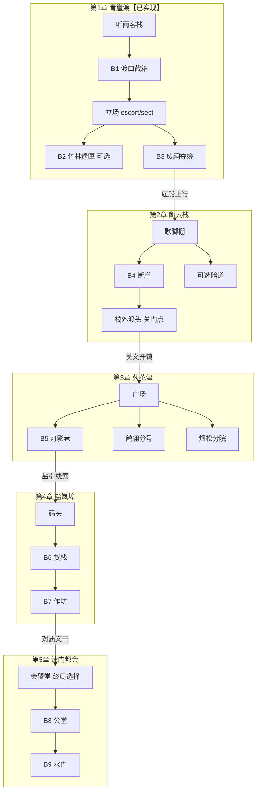

# 武侠战棋 · 大地图剧情大纲 v2.1

> 📌 待办（用户决定 2026-10-15，暂不实现）：大地图改为无缝大地图，取代本稿“每章小区域 + 转场”的结构；落地前需更新大纲与 GDD。

- 版本：v2.1
- 日期：2026-10-15
- 权威规则：`武侠战棋_GDD_v2.0.md`（**【已定】不可违背**）
- 参照气质：《逸剑风云决》（Wandering Sword，2023）式区域漫游、主支线奇遇、队友好感／招募、门派拉扯、关键选择驱动多结局；战斗气质取其对**回合制格子战**的策略侧重（本项目不采用即时制）
- 实现锚点：青崖渡探索 + B1—B3（已实现）；基线工程 `tactics-tri/`
- 状态说明：本文新提案一律标 **【建议】**；与 GDD【已定】冲突处写明**调和方式**，不以参考作覆盖已定规则。
- 人物与门派均为**原创**，不照搬《逸剑风云决》人名、门派名或主线剧情。
- **取代**：本稿取代 `武侠战棋_大地图剧情大纲_v2.0.md`（v2.0 误以《侠客风云传》为参照）。

> **取代关系【建议，待确认】**：本文拟整体取代  
> `武侠战棋_大地图设计_v1.0.md`、`武侠战棋_主线剧情与文案_v1.0.md`，以及已被标注取代的 v2.0 大纲，作为大地图＋剧情的统一大纲。  
> 可保留内容见第 11 节；未确认前 v1.0／v2.0 仍可作实现对照参考。

---

## 1. 参考作品要点归纳：《逸剑风云决》（Wandering Sword）

下列为玩法／结构归纳，**非抄袭清单**；本项目只借「江湖漫游＋人情＋选择后果」的节奏感，不借原作设定与剧情。

### 1.1 已核实要点（附来源）

| 维度 | 已核实内容 | 来源 |
|------|------------|------|
| **定位与美术** | 像素武侠 RPG；虚幻 4；像素角色切入 3D 场景；2023-09 前后正式发售（Steam 约 2023-09-14） | 官网 Spiral Up Games；Steam 商店页 |
| **叙事体量** | 主支线约 200+ 条；选择可改变剧情走向；隐藏／奇遇内容丰富 | 官网 |
| **大地图** | 近百张可探索地图；关外、天山、中原等区域；城镇、山洞秘境、山寨据点等；Steam 英文页称逾 75 处地点、约 5 个多样区域 | 官网；Steam |
| **探索节奏** | 看似开放、实则主线线性推进；**未见强制「日期／时辰」系统**逼迫玩家；可先清区域再推主线（评测观感） | TapTap 专业评测；与攻略「主线推进会关门支线」一致 |
| **可错过内容** | 主线阶段推进、门派等级晋升等会**永久关闭**部分低等级／区域支线与招募窗口；关键节点需多存档 | 玩家 Wiki（wanderingsword.wiki）；游民星空支线梳理 |
| **队友好感** | 多数 NPC 有好感度；送礼、切磋、请教等提升；好感够高可招募入队、开专属剧情、赠神兵秘笈 | 官网；官方 Companion Guide（Steam） |
| **门派／势力** | 武当、少林等正派与玄火教等对立势力并存；门派归属／关键选择可锁定对立内容（待制作时勿照搬名称） | Wiki／攻略与评测交叉印证 |
| **战斗** | 格子战场；可在**回合制**与**即时制**间切换；回合制适合 Boss／单挑／控队友，即时制偏刷怪；站位／背袭有战术价值（背击额外伤害等为攻略说法） | 官网；Wiki |
| **武学养成** | 大量武学与兵器搭配；内功／经脉点数；内外兼修 | 官网；评测 |
| **多结局** | 多种结局变体（攻略／Wiki 常称约 20 种）；受队友好感排序、门派／关键对话、支线完成度、终局战结果等影响；部分坏结局／中断结局存在 | 游民星空结局帖；Steam 讨论；Wiki |
| **道德系统** | **正式版没有落地的道德值／侠义值条**；评测称制作组曾有正邪双线想法，未最终实现 | 17173 鲜游评测（2023-09） |

### 1.2 待核实／仅攻略口径（不得当本作硬事实）

| 条目 | 说明 | 标注 |
|------|------|------|
| 好感招募阈值「约 60」等具体数字 | Wiki／攻略常见说法，未在官网逐条背书 | （待核实） |
| 「完美结局」需清完全部主支线＋最大化好感＋天山特定选项 | Wiki 归纳；条件细节随版本可能变化 | （待核实） |
| 终局「守护江湖」等具体触发句与葬龙谷／天佛窟逐步伤亡规则 | 攻略向；本项目只借「终局显式选择＋队友命运」结构 | （待核实） |
| 世界地图精确分区数（「四区」vs「五区」） | 评测与商店文案不完全一致 | （待核实） |
| 是否存在任何隐藏的正邪隐性累计 | 公开评测强调无道德值；若有隐性标签未见权威说明 | （待核实） |

### 1.3 对本项目的启发（结构层）

| 维度 | 《逸剑风云决》做法 | 对本项目的启发 |
|------|-------------------|----------------|
| **空间** | 多区域、多场景自由走到城镇／秘境／山寨 | 强化「走到」地点；拒绝纯节点点选；首版仍拆成有限小型漫游区 |
| **时间** | **不强调日程／过一天**；用主线阶段关门制造紧迫与重玩 | **不做**侠客风式时辰表；改用**章节窗口／推进关门**（见第 4 节） |
| **养成** | 探索捡招、门派修炼、奇遇秘籍穿插 | 探索奖励落到武学／同伴／战棋变体 |
| **关系** | 好感条＋招募＋专属线＋结局排序 | 借「情谊影响助战／结局」；**不**借无限送礼刷条（见调和表） |
| **势力** | 多门派政治与归属锁定 | 少而精势力轴；允许少量互斥，但主线战术能力须有替代 |
| **任务结构** | 主线推进世界状态；支线丰满人物；奇遇制造意外 | 主线保底可通关；支线／奇遇给流派与结局差分 |
| **结局** | 好感排序＋门派／终局选择＋存活差分，变体很多 | 压缩为少量可辨识主结局＋旁白差分 |
| **战斗** | 格子＋回合／即时双模式 | **只取回合制格子策略**；即时制与经脉刷点不纳入首版 |

### 1.4 与本项目 GDD【已定】的冲突与调和

| 参考作做法 | GDD【已定】／硬边界 | **【建议】调和** |
|------------|---------------------|------------------|
| 近百张图、跨关外—天山的大世界感 | **小型可自由行走区域**；首版不以大型开放世界为目标；设计主轴 A 战棋 > B 武学 > C 叙事 | 五章「小型漫游区」＋交互转场；**不做**无缝大地图、游荡刷怪圈 |
| 回合／即时自由切换 | 战斗为速度队列＋AP 的传统战棋【已定机制方向】 | **仅回合制战棋**；不提供即时战斗模式 |
| 0—100 好感＋送礼切磋刷满 | 门派关系建议为**事件驱动五档**；授艺靠明确事件，不鼓励无限刷（GDD 10—11） | **人物情谊**用关键事件档（疏远／普通／信赖／生死交）＋旗标；可保留「切磋一次」「关键对话」作升档事件，**无日常送礼刷条** |
| 拜入一门派锁定大量对立内容 | 不强制主角终身单门派；武学有限自由混搭；共用谱库＋独立学习【已定】 | 可「客卿学艺／短期寄居」；对立锁定只用于**叙事与可选武学**，通关必需功能须有替代 |
| 主线推进永久关掉大量支线 | 叙事服务于关卡；关键武学主线保底 | **有限章节窗口**：每章列出「推进前建议完成」清单；错过不卡主线、不锁唯一解武学；允许少量专属结局文本差分 |
| 经脉点数、兵器熟练等多套养成 | 避免多套竞争成长货币（GDD） | 不引入经脉／熟练度条；成长仍用等级、心得、谱库、装备 |
| 像素切入 3D 场景 | 探索与战棋均为精致像素＋斜 45°【已定视觉方向】 | 借其「场景有纵深层次」的氛围目标；实现仍服从本项目已定 2D／等距方案，不强制上 3D 场景管线 |

---

## 2. 世界观【建议】

### 2.1 一句话

**漕河九湾**是连通山门与盐埠的内河商路。官家用**渡簿**记谁走过哪段水；镖行凭契护送；山门凭印稽查。近年有人改簿、造契、换泥——不是简单劫镖，而是要把某些人从「水路历史上」抹掉。

### 2.2 玩家身份

三人小队并非名门嫡传，而是在青崖渡被卷进「两份货单」的过路武者（战术原型：剑／枪／拳）。剧情称呼可用「渡口同行」；正式姓名见第 6 节（原创）。

### 2.3 主题

- **名单权**：谁有权决定「谁该被记住、谁该消失」。
- **契与印**：守约与核验都可能是正义，也可能沦为刀柄。
- **人情与选择**：结交、站队、断后式抉择改变谁站在终局身边——借《逸剑》人情江湖，不借其具体人物线。
- **战棋优先**：每段剧情最终落到可辨识的战场目标（歼灭、取物撤离、败首领取证、护送坚守等）。

### 2.4 气质

冷青水面、竹影、残祠、灯下对质；少飞升玄幻，多人间算计与武学规矩。视觉服从 GDD：斜 45°、精致像素。场景层次可追求「渡口／市镇／栈道」可辨识地貌差，但不扩成九州观光。

### 2.5 与既有大纲的关系

保留「内河商路＋渡簿造假」主轴与青崖渡实现；将 v2.0 中偏《侠客风云传》的**日程驱动**改为偏《逸剑风云决》的**区域清扫＋主线关门＋人情结局**；空间仍拆成有限区域。

---

## 3. 大地图结构与地点【建议】

### 3.1 总原则（服从【已定】）

- 大地图＝**章节／区域的组织与解锁节奏**，不是可点击章节节点 UI。
- 每一章＝**1 张（或室内外各 1）小型可自由行走漫游图**＋若干**独立战棋关卡**。
- 跨区用门口／渡口／栈道／关文等**走到并交互**切图；探索移动为实时八向连续，无战棋 AP。
- 战斗地图不要求与探索瓦片 1:1。
- **【建议】**每章提供「可清扫清单」（支线／奇遇／情谊事件），主线出口交互前用软提示列出未完成项；玩家可强行推进。

### 3.2 世界轴（五区域，可回访）

```text
【建议】漕河九湾地理示意（河水大致西←→东；北为山门余脉）

        北 · 栖霞余脉 / 山门分院
              │
    ┌─────────┼─────────┐
    │         │         │
  断云栈    青崖渡     荻花津
  (Ch2)     (Ch1)      (Ch3)
    │         │         │
    └──── 盐岚埠 ──────┘
           (Ch4)
              │
         津门都会
           (Ch5 收束)
```

| 区域 ID | 章 | 地名 | 定位（逸剑风式功能对照） |
|---------|----|------|--------------------------|
| `region_qingyadu` | 1 | **青崖渡** | 起点村镇渡口；客栈据点＋野外竹林／废祠【已实现】≈「落家／关外起点」体量的压缩版 |
| `region_danyun` | 2 | **断云栈** | 山野栈道＋歇脚棚；护送／暗道；推进前清扫窗口 |
| `region_dihuajin` | 3 | **荻花津** | 小型市镇；镖行分号与山门分院同镇对峙≈「城镇＋双势力驻地」 |
| `region_yanlan` | 4 | **盐岚埠** | 码头货栈；伪簿作坊主线；证人／信使类可错过支线 |
| `region_jinmen` | 5 | **津门都会** | 会盟／水门终局；结局检定与显式终局选择 |

> 地名相对早期「雾津镇／河湾盐埠／都会口／上游古栈道」做了原创微调；**青崖渡名称与 B1—B3 实现保持不变**。

### 3.3 第 1 章《青崖渡》——【已定结构＋已实现】

室外 48×30、客栈 14×10；地点与旗标以 GDD 第 12—15 章及现网为准。

| 地点 | 类型 | 战斗／功能 |
|------|------|------------|
| 听雨客栈 | 据点 `explore_hub` | 接任务、立场、谱库、演武、整备 |
| 渡口 | 主线 | **B1《渡口截箱》** |
| 竹林旧道 | 可选 | **B2《竹林遗匣》** |
| 废祠 | 主线 | **B3《废祠夺簿》**（escort／sect 变体） |

旗标：`S0` 接任务 → `S1` B1 → `S2` 学谱／演武／选立场 → `S3` B2 可选或 B3 → 取渡簿结章。  
立场仅一次；B2 非 B3 前置；首通奖励一次性。

**【建议】逸剑风味补强（不改已实现碰撞与战斗 ID）**：

- 客栈增加一次「酒客传闻」奇遇入口（见第 8 节），奖励调查旗标或少量道具，**不**重复发 B1—B3 奖励；触发不依赖昼夜系统。
- 结章「雇船上行」交互前，软提示：未做 B2／未听传闻仍可离开（窗口关闭后 B2 可标为回访或永久错过——**【建议】**首版允许 Ch2 前随时回访青崖渡补 B2，Ch3 起再关门）。

### 3.4 第 2 章《断云栈》【建议】

| 地点 ID | 功能 | 类型 |
|---------|------|------|
| `camp_shed` 断云歇脚棚 | 临时据点（存档、弱整备）；清扫清单板 | 探索 |
| `cliff_pass` 断崖关卡 | 主线 **B4**：护送知情商旅或坚守关口 | 战棋 |
| `smuggle_cave` 走私暗道 | 可选：取证＋撤离（B2 机制变体） | 战棋可选 |
| `upstream_ferry` 栈外渡头 | 核对拓片 → 开往荻花津；**推进关门点** | 探索转场 |
| `herb_slope` 药坡 | **奇遇**：采药／救跌落药农（见第 8 节） | 探索 ± 小战 |

### 3.5 第 3 章《荻花津》【建议】——市镇与双驻地核心章

| 地点 ID | 功能 | 类型 |
|---------|------|------|
| `jin_square` 荻花广场 | 连续漫游主区；市集、传闻板、清扫清单 | 探索 |
| `crane_branch` 鹤翎分号 | 镖行侧支线／切磋（偏 escort） | 探索 ± 切磋战 |
| `mistpine_court` 烟松分院 | 山门侧支线／师承条件（偏 sect） | 探索 ± 切磋战 |
| `night_lane` 灯影巷 | 主线 **B5**：巷战、侧袭强化 | 战棋 |
| `old_archive` 旧籍楼 | 可选谱库扩展 | 探索／可选战 |
| `tea_house` 半日茶寮 | 人物线枢纽（完成指定支线／情谊事件后开放深度对话） | 探索 |

立场后果在此章**显性化**：对立侧戒备，**不封死**夜巷主线入口。

### 3.6 第 4 章《盐岚埠》【建议】

| 地点 ID | 功能 | 类型 |
|---------|------|------|
| `salt_wharf` 盐岚码头 | 漫游＋封锁线调查 | 探索 |
| `warehouse_row` 货栈长廊 | 主线 **B6**：多箱分路（B1 课进阶） | 战棋 |
| `forge_ledger` 墨引作坊 | 主线 **B7**：首领＋取证（B3 课进阶） | 战棋 |
| `neutral_inn` 渡引客栈 | 整备据点 | 探索 |
| `night_watch` 更鼓台 | **奇遇**：截伪簿信使（一次；与主线并行，非时辰锁） | 探索 ± 战 |

### 3.7 第 5 章《津门都会》【建议】

| 地点 ID | 功能 | 类型 |
|---------|------|------|
| `guild_hall` 九湾会盟堂 | 回顾关键选择；展示结局倾向；**终局显式选择** | 探索 |
| `court_yard` 公堂外院 | 主线 **B8**：援军变体随立场／情谊 | 战棋 |
| `river_gate` 水门 | 终局 **B9** | 战棋 |
| `epilogue_dock` 尾声码头 | 结算、回访 | 探索 |

### 3.8 跨章连接【建议】



**不做**：开放世界无缝、章节节点点击、游荡遭遇刷怪圈、即时制战斗模式。

---

## 4. 时间与「章节窗口」（非日程）【建议】

### 4.1 设计目标

《逸剑风云决》**不强调日期／时辰日程**（见 §1.1），而以主线阶段推进关闭支线与招募窗口。本项目对齐该节奏，**撤销 v2.0 的轻量三相位日程作为核心系统**，避免为「等人／卡夜」额外做一套模拟人生式时间。

### 4.2 章节窗口模型

| 概念 | 含义 | 玩家可见性 |
|------|------|------------|
| **区域开放** | 进入某 `region_*` 后，该章支线／奇遇／情谊事件可接 | 地图与任务板列出 |
| **清扫清单** | 据点木板列出本章可完成项（已完成打勾） | 明确、可忽略 |
| **推进关门** | 执行跨区主线交互（雇船／交关文／赴盐岚等）时，关闭**已声明**的可错过项 | 交互前二次确认＋列出将关闭项 |
| **回访例外** | 少数项允许跨章回访（如 Ch1 的 B2 至 Ch3 前） | 清单标注「可回访至关卡 X」 |

- **【建议】**不设上午／午后／夜相位，不设「休息过一天」。
- **【建议】**若某战棋在叙事上需要夜战氛围（如 B5 灯影巷），用**进入该战前的过场／旗标**表现，不依赖全局昼夜循环。
- **【已定边界】**探索仍无 AP；窗口不是战斗资源。

### 4.3 与事件触发

| 触发类型 | 条件例子 | 说明 |
|----------|----------|------|
| 主线门闸 | 旗标（如 B5 需 `stance` 已选＋B1/B3 进度） | 条件不足给线索提示，不封死道路（服从 GDD） |
| 人物情谊 | 指定事件完成次数＋主线进度 | 替代刷好感条与卡时段对话 |
| 奇遇窗口 | 章节内、未完成、一次；推进关门后关闭或降级 | 错过不卡主线 |
| 门派关系 | 仅关键事件改五档 | 与 GDD 11 一致 |

### 4.4 养成节奏（服从已定成长）

窗口服务的是**何时还能做支线／奇遇／切磋**，不是另开「时辰练功」。

- 练功／学招：仍在据点谱库与演武区（共用谱库、独立学习精进【已定】）。
- 切磋：人物线或门派事件开放的有限高手战，奖励秘籍或心得。
- **禁止**：靠反复打低难度遇敌刷武学熟练度；不引入《逸剑》式经脉点养成。

### 4.5 第一章落地范围【建议】

Ch1 已实现**不强改**时间系统：不强制加入 `day_phase`。  
**【建议】存档字段**改为（version bump 时再做）：`current_region_id`、`chapter_windows{}`（或 `missables_closed[]`）、`affinity{}`、`encounters_done[]`、`ending_flags`；Ch1 现有 `ChapterState` 全部保留兼容。

---

## 5. 主线章节大纲【建议】

总体一句话：从青崖渡「两份货单」追到盐岚伪簿网，在津门揭开改簿者——第一章立场、中途人物情谊与终局显式选择，决定谁助战、谁冷眼、尾声如何书写名单。

### 第 1 章《青崖渡·两份货单》——骨架【已实现】；文案可替换样例

| 节拍 | 行动 | 内容 |
|------|------|------|
| 起 | 听雨客栈接委托 | 失踪封箱、两份货单 |
| 承 | B1 渡口截箱 | 《回锋剑谱》入谱库 |
| 转 | 回客栈学谱／演武；听鹤翎与烟松说辞 | 立场 `escort` 或 `sect`（一次） |
| 合 | B3 废祠夺簿；B2 可选 | 渡簿入手；《截脉指》可选 |
| 尾 | 划去的不是死者，是走过水路的人 | 雇船 → 断云栈（确认清扫项） |

### 第 2 章《断云栈·拓片未干》【建议】

- **钩子**：渡簿残页指向栈道驿吏曾登记又被涂改的商队。
- **冲突**：关卡兵与走私者抢先毁证。
- **战棋**：B4 护送／坚守；可选暗道取证。
- **窗口**：赴荻花津前关闭暗道／药坡未接奇遇（或标永久错过）。
- **收获**：伪簿网不止青崖；关文去荻花津。
- **不揭示**主使真名。

### 第 3 章《荻花津·契上应护，印上应扣》【建议】

- **钩子**：同镇两势力公开扯皮盐引。
- **冲突**：契与印互相否定；镇民看外来人站哪边。
- **立场显性化**：分号／分院热络度随 `stance` 变化；**B5 两侧都能进**。
- **人物线**：茶寮与切磋事件推动同伴或关键 NPC 情谊档（事件驱动，非送礼）。
- **收获**：指向盐岚埠改簿窝点。

### 第 4 章《盐岚埠·死人名额》【建议】

- **钩子**：货栈卖「已死过的名字」给活人过关。
- **冲突**：作坊主视改簿为「成本最优」。
- **战棋**：B6 分路货栈；B7 首领＋取证。
- **可错过**：证人护送、信使奇遇 → 影响结局旁白完整度，不影响击败主使。
- **收获**：半封主使书信 → 津门。

### 第 5 章《津门·谁从水上消失》【建议】

- **钩子**：会盟堂摊开货单、渡簿、拓片、书信。
- **冲突**：主使指控玩家「偏帮」；战前回顾立场与情谊。
- **终局显式选择**【建议】（借《逸剑》终局对话分支结构，内容原创）：例如「先夺水门」／「先公堂对质」／「守护通渡之名（保全证人优先）」——改 B8／B9 顺序、援军或胜利文本，皆可通关。
- **战棋**：B8 援军变体；B9 水门终局。
- **收束**：伪簿网拆除；名单昭雪程度随收集与情谊变化；具体结局见第 9 节。

### 成长投放节奏【建议】（关键保底＋可选强化）

| 章 | 主线保底 | 可选强化 |
|----|----------|----------|
| 1 | 《回锋剑》、心得×1、渡簿 | 《截脉指》（B2） |
| 2 | 枪／棍或轻功功能招、心得×1 | 暗道秘籍、药坡消耗品 |
| 3 | 立场相关授艺（有功能等价替代） | 切磋武学、旧籍楼 |
| 4 | 心得×2、关键装备 | 作坊隐藏饰品、信使奇遇碎片 |
| 5 | 结局向叙事／可选招式 | 无强制 |

---

## 6. 主要人物与队友好感【建议】（原创）

立绘与场景表现服从 GDD 已定美术方向（精致像素、斜 45°）。

### 6.1 同行三人（战术原型已有）

| 人物 | 定位 | 动机 | 台词风格 |
|------|------|------|----------|
| **沈照白**（剑客） | 游锋；半侧身青灰短披 | 查清错案，不愿站死队 | 短句、讽喻 |
| **秦守川**（枪客） | 守线；枪影破画 | 先护路与人，再谈对错 | 稳、职责口吻 |
| **周问脉**（拳师） | 通脉；拳腕缠布 | 厌恶伪造与乱脉之事 | 比喻、提问 |

> 实现层可继续用 A／B／D 单位 ID；正式显示名以此表为准（可再审）。

### 6.2 第一章关键 NPC（与现实现称呼对齐处保留）

| 人物 | 动机 | 备注 |
|------|------|------|
| 听雨客栈**掌柜** | 渡口秩序＝生意；怕得罪任一方 | 接任务【已实现】 |
| **孟秋白**·鹤翎镖行 | 守约护箱 | `choose_escort`【已实现】 |
| **洛青禾**·烟松一脉 | 核验暗记 | `choose_sect`【已实现】 |
| **余七** | 市井见闻，递印泥线索 | GDD 样例，建议保留 |

**【建议】**组织显示名统一为「鹤翎镖行／烟松门」，存档键仍用 `escort`／`sect`。

### 6.3 后续章关键人物【建议】

| 人物 | 章 | 作用 |
|------|----|------|
| 驿吏**沈陌** | 2 | 握涂改前拓片；官话多破绽 |
| 走私头目**断渠** | 2 | 毁证；败后可换情报 |
| 分号管事**鹤翎·阿棠** | 3 | 维护孟秋白路线；可升情谊 |
| 执事**烟松·冷筝** | 3 | 维护洛青禾稽查；可升情谊 |
| 茶寮老板**半日** | 3 | 人物线枢纽（事件后开放） |
| 作坊主**墨引** | 4 | 「死人名额」温和恐怖 |
| 主使**裴渡影** | 5 | 以「划去祸种」自洽其恶 |

### 6.4 人物情谊（替代参考作好感刷）【建议】

借《逸剑》「好感 → 助战／专属／结局排序」的**后果结构**，不用 0—100 送礼条。

| 档 | 名称 | 典型后果 |
|----|------|----------|
| 0 | 疏远 | 仅功能对话 |
| 1 | 普通 | 基础支线 |
| 2 | 信赖 | 切磋／助战预告／额外情报；接近「可并肩」 |
| 3 | 生死交 | 终局援军、特殊战棋变体，或结局并列优先权 |

- 每人关键线 **2—3 次事件**升档（对话抉择、并肩战、完成其委托、一次限时切磋等）。
- **【建议】队内三人**各有一条情谊线，影响结局旁白与 B8 是否多一名「临时援军」；不强制恋爱线，不做后宫向数值竞赛。
- **【建议】结局排序**：若两名关键人物同为生死交，用「谁的关键线完成更完整」或终局对话显式选择打破平局——借《逸剑》好感排序思路，规则对本作透明化。

---

## 7. 门派与江湖势力【建议】

服从 GDD：门派＝武学谱系＋剧情关系＋关卡变化；五档事件驱动；不强制终身单门派；功能等价授艺。

### 7.1 首版势力表（少而精）

| 势力 | 象征 | 第一章角色 | 关系键 |
|------|------|------------|--------|
| **鹤翎镖行** | 契、箱、工期 | 孟秋白 | `escort` 轴 |
| **烟松门** | 印、暗记、稽查 | 洛青禾 | `sect` 轴 |
| **漕帮散人** | 码头规矩、中立生意 | 掌柜、余七 | 中立据点 |
| **墨引伪簿网** | 改名、死人名额 | Ch4—5 敌对 | 主线反派组织 |
| **津门官面** | 会盟、公堂 | Ch5 | 终局舞台，不作刷声望 |

### 7.2 关系五档（沿用 GDD 建议）

`-2 敌对` … `+2 信任`；仅关键事件变更；UI 明示后果。

### 7.3 与参考作的差异

- 不设武当／少林／玄火教等原作门派，不设十余门派全局声望矩阵。
- 荻花津「同镇两驻地」即可打出《逸剑》式门派拉扯感。
- **【建议】**允许 Ch3 一条「公开调解」支线同时小幅提升两侧关系（对《逸剑》「归属锁死对立」的温和改写），以保障 `E_balance` 可达成。

---

## 8. 侠义／道德取向【建议】

### 8.1 参考作事实

《逸剑风云决》**无已落地的侠义值／道德值系统**（§1.1，17173 评测）。取向主要通过对话选项、救人／弃人、门派立场与终局选择体现。

### 8.2 本项目做法（原创压缩）

不设可见的 0—100「侠义条」或正邪双主线。  
**【建议】采用「取向旗标」**（存档可读、UI 可在会盟堂回顾）：

| 旗标 ID | 触发例 | 叙事用途 |
|---------|--------|----------|
| `mercy_spare` | 战棋中对特定溃兵／断渠选择「留活口」 | 证人更多、灰烬结局更难触发 |
| `name_restore` | 主动帮「被划名者」家属（奇遇 `enc_ferry_ghost`） | 尾声名单昭雪文本 |
| `means_dark` | 为取证选择嫁祸或牺牲中立第三者（显式警告） | 倾向 `E_ash` 旁白；**不**锁武学 |
| `stance` | 已有 escort／sect | 继续作为主轴之一 |

- 旗标只由**少数显式选择**写入，不隐藏累计。
- 与情谊、门派五档一起参与结局检定；任一「恶手段」不阻止通关。

---

## 9. 支线与奇遇【建议】

### 9.1 分层

| 类型 | 数量控制 | 奖励原则 |
|------|----------|----------|
| **主线** | 每章 1 条推进轴 | 保底武学／关文／证物 |
| **支线** | 每章 1—2 条 | 秘籍、情谊、装备；可错过 |
| **奇遇** | 全游戏约 6—8 个窗口 | 意外感＋轻度奖励；**不卡主线** |

### 9.2 支线示例

| ID | 章 | 摘要 | 战棋／探索 |
|----|----|------|------------|
| `side_bamboo` | 1 | 竹林遗匣 | B2【已实现】 |
| `side_cave` | 2 | 走私暗道取拓片副本 | 取物撤离 |
| `side_crane` | 3 | 分号委托：护一夜盐引账 | 切磋或小歼灭 |
| `side_mistpine` | 3 | 分院委托：核对假印泥 | 调查＋可选战 |
| `side_archive` | 3 | 旧籍楼机关 | 探索／可选战 |
| `side_witness` | 4 | 货栈证人护送 | 护送战 |
| `side_mediate` | 3 | 调解契印误会（可选，助 `E_balance`） | 探索＋对话检定／小战 |

### 9.3 奇遇示例（原创，非照搬原作事件）

| ID | 窗口 | 触发【建议】 | 内容 | 奖励边界 |
|----|------|--------------|------|----------|
| `enc_inn_rumor` | Ch1，B1 后至 Ch3 雇船前 | 客栈与酒客交互＋`b1_clear` | 醉语指向竹林另一处封漆痕 | 调查文本／小道具；不发第二份《回锋剑》 |
| `enc_herb` | Ch2，赴津前 | 歇脚棚接线索 → 药坡 | 救药农或驱兽 | 消耗品或轻功线索 |
| `enc_tea_riddle` | Ch3 | 茶寮＋情谊≥1 | 半日出谜换旧籍楼钥匙线索 | 开启 `side_archive` |
| `enc_night_watch` | Ch4，B7 前 | 更鼓台调查 | 截伪簿信使 | 书信碎片（丰满结局文本） |
| `enc_duel_road` | Ch3—4 | 主线间隙伪随机一次 | 无名高手路遇切磋 | 一门特征武学或心得×1 |
| `enc_ferry_ghost` | 回访青崖渡 | `ch01.complete` | 「被划名者」家属求纸 | `name_restore` 旗标＋结局旁白 |

**纪律**：奇遇失败或错过 → 主线仍可通；不把唯一解武学放在奇遇里；推进关门必须预告。

---

## 10. 多结局条件【建议】

目标：像《逸剑风云决》有「好感／选择／终局对话共同收束」的感觉，但分支数量可控（约 3—4 个主结局＋旁白差分），不做约 20 变体。

### 10.1 检定输入（存档可读）

1. **第一章立场**：`escort`｜`sect`（已定机制）  
2. **门派关系档**：鹤翎／烟松五档（由关键事件累积）  
3. **人物情谊**：至少统计孟秋白、洛青禾、沈陌、半日、队内三人中的关键档；若并列生死交则看关键线完成度或终局选择  
4. **取向旗标**：`mercy_spare`／`name_restore`／`means_dark` 等  
5. **伪簿处理**：Ch4 证人支线、书信碎片（影响旁白，不影响能否打赢 B9）  
6. **终局显式选择**：会盟堂开战前一项（见第 5 章）

### 10.2 主结局【建议】

| 结局 ID | 名称 | 主要条件（示意） | 战棋／叙事差异 |
|---------|------|------------------|----------------|
| `E_contract` | **守契长河** | `escort` 为主＋鹤翎≥友好＋未与烟松敌对崩盘＋孟秋白情谊较高 | 终局偏镖行助阵；旁白强调活人与契约 |
| `E_seal` | **核印清流** | `sect` 为主＋烟松≥友好＋对称约束＋洛青禾情谊较高 | 偏山门助阵；旁白强调除蠹与名册 |
| `E_balance` | **九湾共渡** | 两派均≥中立且完成 `side_mediate`（或等价消误会）＋无 `means_dark` | 两派有限协力；难度／援军取中 |
| `E_ash` | **簿烬难收** | 两派均≤戒备，或证人线全弃＋书信不足，或累计 `means_dark` | 仍可击败裴渡影，昭雪不全、尾声更冷；**可通关** |

**【建议】队内情谊旁白差分**：在以上主结局内嵌短段落（谁留下共渡、谁分道），不另开恋爱结局树。

### 10.3 禁止项

- 不因结局锁死已收录武学。  
- 不要求收集全部奇遇才能「真结局」。  
- 「灰烬」结局必须可打完 B9，只改叙事与部分援助。  
- 不照搬《逸剑》具体结局人名与触发表。

---

## 11. 内容类型标签与数据扩展【建议】

| `content_type` | 含义 |
|----------------|------|
| `explore_hub` / `explore_roam` | 据点／漫游 |
| `battle_*` | clear／pickup_evac／leader_pickup／escort_hold／variant |
| `transfer` | 跨区切图 |
| `chapter_gate` | 推进关门点（确认将关闭的可错过项） |
| `encounter` | 奇遇入口 |
| `affinity_event` | 情谊升档事件 |

**【建议】存档新增**（version bump 时再做）：`current_region_id`、`chapter_windows`／`missables_closed[]`、`affinity{}`、`orientation_flags{}`、`encounters_done[]`、`ending_flags`；**不优先**引入 `day_phase`。Ch1 现有字段全部保留兼容。

实现纪律：不改 `storyteller/`、`warchess-pixel/`、`frost/`、`builds/`；落地继续在 `tactics-tri/`。

---

## 12. 与 v2.0 的区别及可保留内容

### 12.1 主要区别

| 维度 | v2.0（参照《侠客风云传》） | v2.1（本稿，参照《逸剑风云决》） |
|------|---------------------------|----------------------------------|
| 参照作品 | 《侠客风云传》式日程／市井 | 《逸剑风云决》式区域清扫、人情、多结局、格子回合战 |
| 时间系统 | 轻量三相位日程 | **章节窗口／推进关门**；不做时辰表 |
| 好感 | 事件档（已有） | 事件档＋**结局排序／并列打破**规则写清；明确拒绝送礼刷条 |
| 道德 | 未单列 | **取向旗标**（因参考作无侠义条而原创压缩） |
| 战斗借鉴 | （未强调） | 明确只借回合制格子，不借即时制 |
| 奇遇／支线 | 有 | 保留并加上**关门预告**与清扫清单 |
| 地名／青崖渡／B1—B3 | 已定实现 | **全部保留** |
| 人物名 | 沈照白等 | **保留**（仍为原创，与《逸剑》无关） |

### 12.2 可保留（建议直接继承）

- **【已定／已实现】**青崖渡 48×30＋客栈、B1—B3、立场 `escort`／`sect`、B3 变体、任务状态机、一次性奖励、失败回滚。  
- 五章「区域轴＋交互转场」总体结构与断云栈／荻花津／盐岚埠／津门地名。  
- 门派事件驱动五档、功能等价授艺、B2 可选不卡 B3。  
- 「渡簿／两份货单／划去水路之名」核心谜面与第一章关键对白骨架。  
- 原创人物表（沈照白、秦守川、周问脉、孟秋白、洛青禾、裴渡影等）。  
- 3—4 主结局框架（守契／核印／共渡／灰烬）——检定输入按 v2.1 增补取向旗标与情谊排序。  
- `WorldRegionDefinition`／地点／连接字段思路与验收：「可走到门口，锁定用对话」。  
- 写作纪律：战前短对白、立场战棋后果预告、叙事服从关卡。

### 12.3 需替换或降级

- v2.0「上午／午后／夜」日程与 `day_phase` 优先方案 → **降级为不采用**；改章节窗口。  
- 以《侠客风云传》为气质参照的表述 → 全部改为《逸剑风云决》并区分已核实／待核实。  
- 把「完整 NPC 日程／恋爱向好感竞赛」当作目标 → **明确不做**。  
- 把「真结局＝清完全部奇遇」当作目标 → **明确不做**（与参考作攻略向「完美结局」拉开距离）。

### 12.4 后续文案工作

本稿不替代逐句对白表。确认 v2.1 后，可另开《主线文案 v2.x》把各章任务句、关门确认框与对白写死；实现前继续可用 v1.0／现网第一章已实现字符串。

---

## 13. 验收要点【建议】

- [ ] 玩家能感到「城镇／野外／门派驻地可走」，但不认为这是开放世界。  
- [ ] 无强制日程；推进跨区前有清扫清单与关门预告。  
- [ ] Ch1 与现网 B1—B3／立场完全兼容。  
- [ ] 支线／奇遇可全错过仍通关；灰烬结局可打完。  
- [ ] 情谊与取向由显式事件／选择产生，无送礼刷条、无隐藏道德条。  
- [ ] 无任何条文要求违背：自由行走探索、战棋独立网格、共用谱库、独立等级、3+1+1、五格控制区等 GDD【已定】项。  
- [ ] 不引入即时制战斗或经脉养成。  
- [ ] 人名、门派、主线情节均为原创，未复制《逸剑风云决》剧情。

---

## 14. 版本记录

- **v2.1（2026-10-15）**：参照作品更正为《逸剑风云决》；联网核对官网／Steam／评测／攻略后区分已核实与待核实；以章节窗口取代 v2.0 日程；补充取向旗标、清扫关门与情谊结局排序；保留青崖渡与 B1—B3 及原创人物世界观。  
- **v2.0（2026-10-15）**：原参照《侠客风云传》；**已被本稿取代**。
