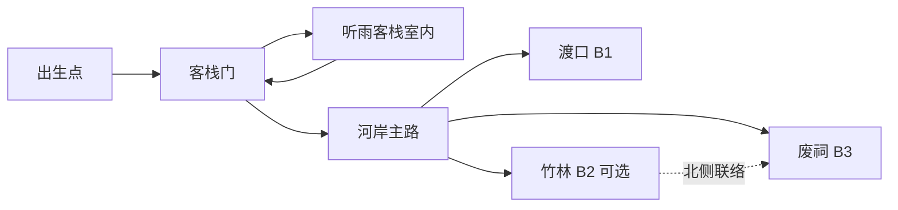
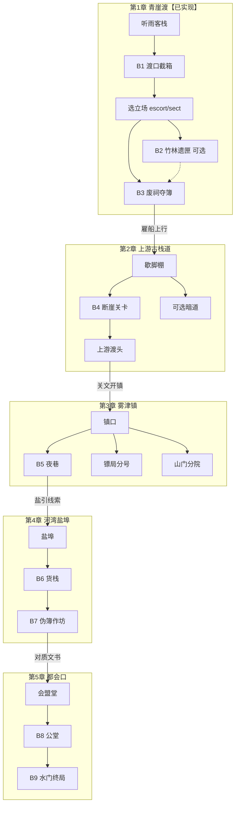

# 武侠战棋 · 大地图设计 v1.0

- 版本：v1.0
- 日期：2026-10-15
- 权威规则：`武侠战棋_GDD_v2.0.md`
- 衔接实现：`tactics-tri/data/wuxia/`（青崖渡探索、B1—B3、客栈立场）
- 状态说明：**【已定】**沿用 GDD；**【建议】**为本文件新增提案，可调。

---

## 0. 与 GDD【已定】的边界

| 项目 | 状态 | 本文件如何遵守 |
|------|------|----------------|
| 探索形式 | **【已定】**小型可自由行走区域地图；不采用「点击章节节点进关」 | 大地图是**章节/区域组织与解锁节奏**，不是可点击节点 UI |
| 探索移动 | **【已定】**实时八向连续移动，无战棋 AP | 区域内仍走探索控制器；跨区用门口/渡口/栈道等交互切图 |
| 战斗地图 | 独立战棋网格（建议） | 探索地点可触发战斗，但战斗地图另定义，不要求与探索瓦片 1:1 |
| 首章结构 | GDD 第 12—15 章《青崖渡》 | 第 1 章地点、旗标、B1—B3 与现网数据一致 |
| 门派关系 | 【建议】事件驱动五档 | 立场只改关系与关卡变体，不封死主线通路 |

**不做**：开放世界无缝大地图、章节节点点击推进、游荡遭遇刷怪圈、马匹跨洲。

---

## 1. 世界总览【建议】

游戏世界落在一条**内河商路**上：下游渡口、中游集镇、上游古栈与山门。首版不以「九州全图」为目标，而以 **5 个可漫游区域（章）** 串起主线。

```text
【建议】世界地理示意（西 ← → 东 为河水流向；北为山地）

        北 · 山门 / 青岚余脉
              │
    ┌─────────┼─────────┐
    │         │         │
  古栈道    青崖渡     雾津镇     （第2—4章区域轴）
  (Ch2)     (Ch1)      (Ch3)
    │         │         │
    └──── 河湾盐埠 ────┘
           (Ch4)
              │
         下游都会口
           (Ch5 收束)
```

| 区域 ID | 章 | 地名 | 一句话定位 |
|---------|----|------|------------|
| `region_qingyadu` | 1 | 青崖渡 | 已实现；听雨客栈据点 + 渡口/竹林/废祠 |
| `region_stackroad` | 2 | 上游古栈道 | 渡簿指向的上游线索；栈道、关卡、走私暗道 |
| `region_wujin` | 3 | 雾津镇 | 两派对峙公开化；市集、镖局分号、山门分院 |
| `region_yanbu` | 4 | 河湾盐埠 | 伪造名单落地；货栈、码头封锁战 |
| `region_dukou_city` | 5 | 都会口 | 主线收束；公堂/会盟与最终战棋 |

每章 = **1 张（或室内外各 1 张）小型漫游图** + 若干独立战棋关卡。章与章之间用「渡船开航 / 栈道解封 / 关文」等剧情交互切换区域，**不是**点击世界节点。

---

## 2. 地点列表与功能【建议】

### 2.1 第 1 章《青崖渡》——与现实现衔接【已定结构 + 实现对照】

室外 **48×30**、客栈室内 **14×10**（GDD 12.1 / 蓝图 `qingyadu_blueprint_v1.3.json`）。

| 地点 ID | 探索坐标（编辑格） | 类型 | 功能 | 战斗 / 探索 |
|---------|-------------------|------|------|-------------|
| `explore_spawn` | (8,23) | 出生点 | 章初站位 | 探索 |
| `inn_door` / 听雨客栈 | (8,21) → 室内 | 据点 | 接任务、立场、谱库、演武、整备 | 探索 + UI |
| `ferry_event` / 渡口 | (37,23) | 主线战 | B1《渡口截箱》 | 战棋 `wuxia_b1` |
| `bamboo_event` / 竹林旧道 | (16,7) | 可选战 | B2《竹林遗匣》 | 战棋 `wuxia_b2`（可选） |
| `shrine_event` / 废祠 | (37,8) | 主线战 | B3《废祠夺簿》 | 战棋 `wuxia_b3`（escort/sect 变体） |

**连接关系（已实现）**：



ASCII：

```text
       北
       ↑        竹林旧道 J           废祠 R（B3）
       |            │                  │
       |            └─北侧联络路径──────┤
       |                               │
       |  听雨客栈 I ──── 河岸主路 ──────┤── 渡口 F（B1）── 河水
       +----------------------------------------------→ 东
```

**旗标顺序（与 `ChapterState` / GDD 14 一致）**：

`S0` 接任务 → `S1` B1 → `S2` 回客栈学谱/演武/选立场 → `S3` B2 可选或直奔 B3 → `S4/S5` 取渡簿结章。

**硬约束（已定/已实现）**：

- 立场 `escort`｜`sect` 仅一次；B2 非 B3 前置。
- 首通奖励一次性；失败不改章节旗标。
- 未满足条件时可走到门口，给锁定提示，不无故封路（废祠门锁可剧情开，但门口始终可互动）。

### 2.2 第 2 章《上游古栈道》【建议】

| 地点 ID | 功能 | 探索/战斗类型 |
|---------|------|---------------|
| `camp_lean` 栈道歇脚棚 | 临时据点：存档、简易整备（弱于客栈） | 探索 |
| `cliff_pass` 断崖关卡 | 主线战 B4：守线/护送商旅过关 | 战棋（坚守或护送） |
| `smuggle_cave` 走私暗道 | 可选：取匣式或撤离式（复用 B2 机制变体） | 战棋可选 |
| `ferry_upstream` 上游渡头 | 章末交互：核对渡簿名册 → 开往雾津 | 探索转场 |

**与第 1 章衔接**：B3 结局文案已指向「上游古栈道」；结章后室外青崖渡出现「雇船上行」交互，切到 `region_stackroad` 出生点。青崖渡仍可回访（调查文本），不再重复发 B1—B3 奖励。

### 2.3 第 3 章《雾津镇》【建议】

| 地点 ID | 功能 | 类型 |
|---------|------|------|
| `wujin_square` 镇口广场 | 连续漫游主区；市集 NPC、情报 | 探索 |
| `escort_branch` 白鹭分号 | escort 友好支线 / 切磋授艺 | 探索 ± 战棋切磋 |
| `sect_court` 青岚分院 | sect 友好支线 / 师承条件 | 探索 ± 切磋 |
| `night_alley` 夜巷 | 主线战 B5：巷战、侧袭教学强化 | 战棋 |
| `archive_tower` 旧籍楼 | 可选：谱库扩展秘籍 | 探索/可选战 |

立场后果在此章**显性化**（见剧情文档）：敌对侧 NPC 戒备，但不封死主线入口。

### 2.4 第 4 章《河湾盐埠》【建议】

| 地点 ID | 功能 | 类型 |
|---------|------|------|
| `salt_wharf` 盐埠码头 | 漫游 + 封锁线 | 探索 |
| `warehouse_row` 货栈长廊 | 主线战 B6：多货箱分路（B1 地形课进阶） | 战棋 |
| `ledger_forge` 伪簿作坊 | 主线战 B7：首领 + 交互取证（B3 机制进阶） | 战棋 |
| `neutral_inn` 中立客栈 | 整备据点 | 探索 |

### 2.5 第 5 章《都会口》【建议】

| 地点 ID | 功能 | 类型 |
|---------|------|------|
| `guild_hall` 会盟堂 | 叙事选择回顾、最终立场检定展示 | 探索 |
| `court_yard` 公堂外院 | 主线战 B8：多波/援军变体随立场 | 战棋 |
| `river_gate` 水门 | 终局战 B9：大型网格、Boss | 战棋 |
| `epilogue_dock` 尾声码头 | 结算、回访入口 | 探索 |

---

## 3. 跨章连接总图【建议】



---

## 4. 解锁节奏（按章节）【建议】

| 章 | 解锁条件 | 开放内容 | 关闭 / 降级 |
|----|----------|----------|-------------|
| 1 | 新游戏 | 青崖渡室外+客栈；任务后 B1；立场后 B2/B3 | B1—B3 首通后改调查点 |
| 2 | `ch01.complete` 且与上游渡头交互 | 古栈道区域；B4；可选暗道 | 青崖渡可回访，战斗入口关闭发奖 |
| 3 | 第 2 章主线胜 + 渡头结算 | 雾津镇；按 `stance` 调整分号/分院对话档 | 对立门派 -1 戒备，不锁主线 |
| 4 | 第 3 章主线胜 | 盐埠；B6→B7 | 可选支线可错过，不卡 B7 |
| 5 | 第 4 章取证完成 | 都会口；B8/B9；结局分支展示 | 终局后开放自由回访（无新首通奖） |

**成长投放节奏【建议】**（服从 GDD：关键武学主线保底，可选强化流派）：

| 章 | 主线保底 | 可选强化 |
|----|----------|----------|
| 1 | 《回锋剑》、心得×1、渡簿 | 《截脉指》（B2） |
| 2 | 枪/棍系一招或轻功变体、心得×1 | 暗道秘籍 |
| 3 | 门派条件授艺（与立场相关但有替代功能） | 切磋武学 |
| 4 | 武学心得×2、关键装备 | 作坊隐藏饰品 |
| 5 | 结局向招式/叙事道具 | 无 |

---

## 5. 战斗 / 探索类型标签【建议】

供关卡表与编辑器用：

| `content_type` | 含义 | 示例 |
|----------------|------|------|
| `explore_hub` | 整备据点（谱库/精进/装备） | 听雨客栈 |
| `explore_roam` | 纯漫游调查 | 青崖渡室外、雾津广场 |
| `battle_clear` | 歼灭 | B1 |
| `battle_pickup_evac` | 取物+撤离 | B2 |
| `battle_leader_pickup` | 败首领+取物 | B3、B7 |
| `battle_escort_hold` | 护送/坚守 | B4【建议】 |
| `battle_variant` | 由 `stance` 改地形/部署 | B3 escort/sect |
| `transfer` | 跨区域切图 | 雇船上行 |

---

## 6. 后续数据落地建议字段【建议】

在现有 `qingyadu_blueprint` / `ChapterState` 之上扩展，不推翻 v2 存档字段；新章用 `ch02.*` 等前缀。

### 6.1 `WorldRegionDefinition`

```json
{
  "region_id": "region_qingyadu",
  "chapter": 1,
  "display_name": "青崖渡",
  "explore_scene_ids": ["outdoor", "inn"],
  "unlock_requires": [],
  "hub_scene_id": "inn",
  "transfer_out": [
    {
      "id": "to_stackroad",
      "requires": ["ch01.complete"],
      "destination_region": "region_stackroad",
      "spawn_marker": "stack_spawn"
    }
  ]
}
```

### 6.2 `ExploreLocationDefinition`（地点）

| 字段 | 说明 |
|------|------|
| `location_id` | 如 `ferry_event` |
| `region_id` | 所属区域 |
| `scene_id` | `outdoor` / `inn` / … |
| `pos` | 编辑格或 Marker 名 |
| `content_type` | 见第 5 节 |
| `interaction_id` | 指向交互表 |
| `battle_id` | 可空；如 `wuxia_b1` |
| `requires` | 旗标表达式数组（同现蓝图） |
| `once_flag` | 首通旗标 |
| `return_spawn` | 战斗返回安全点 |
| `locked_dialogue_id` | 条件不足时文案 |
| `post_clear_mode` | `investigate` \| `revisit` \| `hidden` |

### 6.3 `RegionLinkDefinition`（连接）

| 字段 | 说明 |
|------|------|
| `link_id` | |
| `from_region` / `to_region` | |
| `from_marker` / `to_spawn` | |
| `requires` | 如 `ch01.complete` |
| `travel_presentation` | `ferry` \| `gate` \| `fade` |
| `bidirectional` | bool；回访是否开放 |

### 6.4 章节状态扩展（兼容现 `ChapterState`）

现有字段保留：`quest_accepted, b1_clear, lesson_received, stance, b2_clear, b3_clear, ledger_received, complete, escort_relation, sect_relation`。

**【建议】新增**（存档 version  bump 时再做）：

| 字段 | 用途 |
|------|------|
| `current_region_id` | 当前漫游区域 |
| `chapter_index` | 1—5 |
| `ch02_clear` … | 后续章旗标包 |
| `visited_regions[]` | 回访 |
| `faction_relations{}` | 泛化五档关系（可从 escort/sect 两字段迁移） |

### 6.5 实现顺序建议

1. 文档定案（本文件 + 剧情文案）。
2. 数据：先把青崖渡蓝图字段对齐 `ExploreLocationDefinition` 命名（不改玩法）。
3. 工程：`SceneRouter` 支持 `region_id` + transfer；第 2 章先做「歇脚棚 + 一条路 + 一场战」垂直切片。
4. 禁止在 `storyteller/` / `warchess-pixel/` / `frost/` / `builds/` 动刀；继续只在 `tactics-tri/` 落地。

---

## 7. 验收要点【建议】

- [ ] 玩家能说清「大地图」是分章区域，而不是节点点击。
- [ ] 第 1 章地点、坐标、B1—B3、立场与现网一致。
- [ ] 跨章转场有明确交互与安全出生点；失败/回访不重复发奖。
- [ ] 立场只改关系与变体，不封死任一章主线入口。
- [ ] 新区域仍满足：可走到关键门口；锁定用对话而非隐形墙（与 GDD 13.1 一致）。

---

## 8. 版本记录

- **v1.0（2026-10-15）**：初稿。锚定青崖渡已实现内容；提出 Ch2—Ch5 区域轴、连接图、解锁节奏与数据字段建议。
